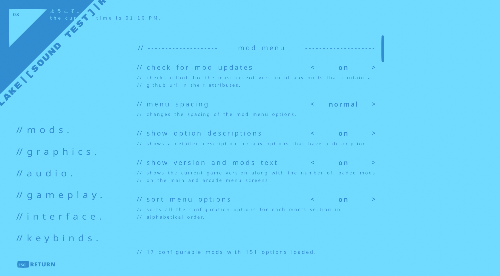
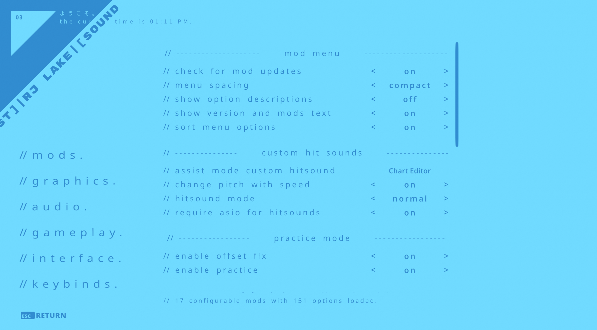

# UNBEATABLE Mod Menu

A mod to add a customizable mod menu to the hit rhythm game UNBEATABLE!

Disclaimer: This is not affiliated with or endorsed by D-CELL GAMES.

## Features

- Gathers configuration automatically from all BepInEx plugins that are loaded.
- Creates an additional category in the Arcade Mode options menu labeled "mods".
- Uses the same UI as the existing menu screens with some slight tweaks for readability.
- Works with any BepInEx configuration type; best supports boolean, number, string, enum, and acceptable value ranges and lists.
- Works with the tag class `ConfigurationManagerAttributes` and a custom class `ModMenuAttributes` to allow more flexibility for Mod Menu setting display.
- Automatically checks for mod updates for any mods that have a GitHub repository URL embedded in the assembly metadata and prompts if updates are found.
- Includes double-click reset to default value functionality for configuration options that use a value range (rendered as a slider in Mod Menu).

## Configuration

The mod menu is accessed from Arcade Mode; simply press "options" on the bottom right (or the J key by default) to enter the Arcade Mode options. Once inside the menu, the "mods" button will open the Mod Menu!

All entries for different plugins are labelled with a large header defining the plugin, with configuration options below each header.
The section for each BepInEx config entry is also shown. The [General] section header is omitted for clarity and is always shown first.

There are five configurable options for Mod Menu:

### Check For Mod Updates

If this is enabled, for any mod assembly DLL files that have embedded metadata including a GitHub repository URL, Mod Menu will automatically check for the latest version, compare it to the current version, and prompt for updates if there is a new version available. The popup includes a handy shortcut to the latest release page!

### Menu Spacing

This controls the spacing between menu items, section headers, titles, and whitespace in the menu. There are four options: Compact, Normal, Expanded, and Comfy, of increasing levels of spacing.

### Show Option Descriptions

This shows more detailed descriptions for every config option, using the descriptions present in the BepInEx config file for any options that have it.

Pictured: Mod Menu with option descriptions disabled, Compact spacing.

### Show Version and Mods Text

Shows text denoting the current version of the game and the number of loaded mods in both the main menu and the Arcade Mode menu.

### Sort Menu Options

Sorts all of the BepInEx configuration entries for each mod's sections in alphabetical order. When disabled, they are sorted in the order that the mod creates them in.

## Custom Tag Attributes

To allow for greater functionality and customizability of how Mod Menu renders and accepts configuration options, Mod Menu includes a custom class `ModMenuAttributes` that works similarly to `ConfigurationManagerAttributes`, which is also supported.

`ConfigurationManagerAttributes.Browsable` is natively supported by Mod Menu, and `ModMenuAttributes` includes a few useful rendering options that you can add to your BepInEx `Config.Bind()` to change how Mod Menu will render your configuration options!

Add `ModMenuAttributes.cs` to your mod's project and include it in the tags of `Config.Bind()` for mod menu to use your custom attributes. Check out the file for more details on what options are available.

## Mod Installation Instructions

For installation instructions, refer to my mod installation guide here:

https://gist.github.com/Stefyfresh/1140bf18c5f3895bd807258c16483887

---

###### All code for Mod Menu was written by me, by hand.
